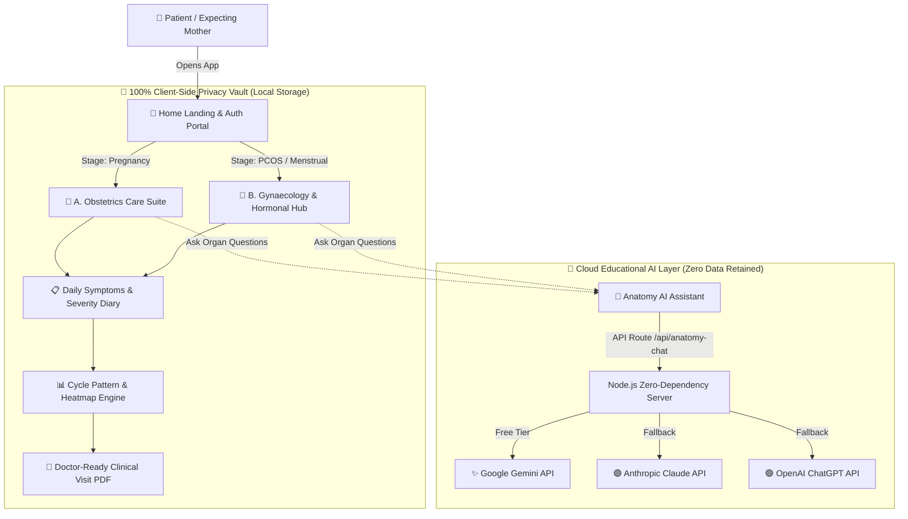

# 🌸 Arogini (आरोगिनी)
### *Empowering Women's Reproductive Health with Clinical Clarity, Dignity & 100% Client-Side Privacy*

<p align="center">
  
</p>

<p align="center">
  <a href="https://github.com/ShrutiChavan-20/Arogini"></a>
  <a href="#"></a>
  <a href="#"></a>
  <a href="https://github.com/ShrutiChavan-20/Arogini/blob/main/LICENSE"></a>
</p>

---

## 💡 The Problem

In India and across the globe, millions of women face deep systemic hurdles when navigating reproductive and maternal health:

- **Cultural Taboos & Stigma**: Hesitancy to discuss menstrual cycles, hormonal imbalances, pelvic pain, or intimacy concerns openly.
- **The "White-Coat Syndrome" & Time Crunch**: In rapid 8–10 minute consultations, over 70% of women struggle to articulate their symptom frequency, severity timelines, or functional life impact.
- **Predatory Cloud Privacy**: Mainstream cycle tracking apps frequently monetize and broker sensitive menstrual and reproductive telemetry to third-party ad brokers.
- **Fragmented Medical Information**: Crucial obstetric timelines, PCOS markers, and trimester red flags are scattered across unverified blogs and medical jargon.

---

## ✨ The Arogini Solution

**Arogini** (*आरोगिनी — The Woman in Good Health*) is an all-in-one, privacy-first reproductive health intelligence platform. It bridges the critical communication gap between patient diary entries and clinical consultations:

1. **🔒 Zero-Cloud Device Vault**: All symptoms, cycle dates, and notes stay strictly in your browser storage. Zero trackers, zero cloud profiling.
2. **🌸 Stage-Adaptive Clinical Routing**: Custom dashboards for **Obstetrics** (Pregnancy & Postpartum) vs. **Gynaecology** (PCOS & Menstrual Health). Non-pregnant patients never see awkward pregnancy calculators.
3. **📋 Doctor-Ready Clinical Summaries**: Automatically converts daily subjective diary entries into an objective, chronological one-page clinical summary exportable as a clinician-formatted PDF.
4. **🧠 Multi-Model Anatomy AI**: Safe, non-diagnostic educational assistant powered by **Google Gemini** (free tier), **Anthropic Claude**, or **OpenAI ChatGPT** with strict clinical safety boundaries.

---

## 🏛️ Core Platform Modules

| Module | Core Capabilities | Clinical Boundary |
| :--- | :--- | :--- |
| **🤰 Domain A: Obstetrics** | • **Gestational Progress Tracker**: Trimester countdown, fetal size comparisons (*Mango, Avocado, Eggplant*), and weekly milestones.<br/>• **ACOG/WHO Antenatal Planner**: Timetables for ultrasounds, OGTT glucose challenges, and blood tests.<br/>• **Emergency Red Flags**: Non-alarmist screening for preeclampsia, bleeding, and severe pain.<br/>• **4th Trimester Care**: Postpartum healing, pelvic floor recovery, and emotional wellness. | Non-diagnostic; follows ACOG & WHO clinical guidelines. |
| **🔬 Domain B: Gynaecology** | • **PCOS & Hormonal Journal**: Hirsutism, hormonal acne, hair thinning, and insulin markers.<br/>• **Cycle & Ovulation Rhythm**: 28-day cycle visualization and luteal/follicular phase insights.<br/>• **Pelvic Pain Diary**: Anatomical quadrant tracking (LLQ, RLQ) and functional impact logs.<br/>• **Interactive Body Map**: Explores uterus, ovaries, fallopian tubes, cervix, and hormonal axis. | Strictly educational; avoids self-prescriptions. |
| **📋 Domain C: Symptoms & Clinical Summaries** | • **Log**: Severity scores (1–5), time of day, and functional impacts (work, sleep, mobility).<br/>• **Patterns**: 28-day chronological heatmaps and recurring cycle correlations.<br/>• **Export**: 1-click **Download PDF** or **Print Summary** for direct presentation to gynecologists. | Structured medical phrasing with objective functional scales. |
| **🤖 Anatomy AI & Curated Videos** | • **Anatomy AI Assistant**: Instant explanations of reproductive organs.<br/>• **Explainer Videos**: 60–90 second clinician-curated educational animations. | Strict non-diagnostic educational boundaries. |

---

## 🧩 System Architecture



---

## 📸 Visual Showcase & Design System

Arogini is built with an empathetic, feminine healthcare design system utilizing soft rose, warm blush, sage green, and deep plum tokens:

| Landing & Auth Portal | Obstetrics Maternal Care | Gynaecology & PCOS Hub |
| :---: | :---: | :---: |
|  |  |  |
| *Separate, elegant Home page with 1-click persona chips & guest explore.* | *Trimester progress, fetal milestones & antenatal checks.* | *Cycle rhythms, PCOS logging & pelvic pain tracking.* |

---

## 👥 Pre-Configured Test Personas

Arogini includes 1-click demo accounts on the landing page for immediate hackathon jury evaluation:

| Persona | Stage | Focus Area | Sample Data Loaded |
| :--- | :--- | :--- | :--- |
| **Priya Sharma** | 🤰 Pregnancy (Wk 19) | Gestation, Ultrasound Scans, Antenatal Visits | Fetal milestones, Level-II scan date, kick logs |
| **Ananya Desai** | 🔬 PCOS Journal | Irregular Cycles (38d), Hormonal Acne, LH/FSH | Cycle logs, insulin resistance markers, pain diary |
| **Meera Patel** | 🩸 Cycle Tracking | Natural Rhythm, Luteal Phase, Pelvic Health | Regular period logs, ovulation tracker, symptom diary |

*Or click **✨ Explore Full Dashboard as Guest** to test immediately without entering credentials!*

---

## 🛠️ Tech Stack & Zero-Dependency Philosophy

- **Frontend**: Vanilla JavaScript (ES6+), Semantic HTML5, Vanilla CSS3 (Design Tokens, Glassmorphism, Micro-animations).
- **Backend**: Zero-dependency Node.js HTTP server (`server.js`) with auto `.env` hot-reloading.
- **PDF Generation**: Client-side vector rendering via `html2pdf.js` with print stylesheets.
- **AI Integration**: Multi-provider adapters for Google Gemini (`gemini-3.5-flash-lite`), Anthropic (`claude-3-haiku`), and OpenAI (`gpt-4o-mini`).
- **Security & Privacy**: Client-side encryption, local PIN protection, zero trackers, zero analytics telemetry.

---

## ⚡ Quickstart Guide (Local Setup in 60s)

### 1. Clone & Enter Repository
```bash
git clone https://github.com/ShrutiChavan-20/Arogini.git
cd Arogini
```

### 2. Configure Environment (Optional for Anatomy AI)
Copy `.env.example` to `.env`:
```bash
cp .env.example .env
```
Add your free Google Gemini API key (or OpenAI / Anthropic):
```env
GEMINI_API_KEY=your_gemini_api_key_here
```

### 3. Start Application
```bash
npm start
```
Open **`http://localhost:3000`** in your browser.

---

## ☁️ Live Cloud Deployment

Arogini is pre-configured with turnkey cloud configurations:

- **Render (Recommended)**: Push to GitHub and deploy with [render.yaml](render.yaml) as a free Web Service.
- **Railway**: Auto-configured via [Procfile](Procfile).
- **Vercel / Netlify**: Fully compatible static & Node.js hosting.

---

## 🩺 Clinical Boundaries & Ethics

> [!IMPORTANT]
> **Non-Diagnostic Medical Disclaimer**: Arogini is an informational and health-organization tool designed to empower women with structured self-reports. It does not provide medical diagnoses, treatment prescriptions, or clinical triage. In the event of severe acute pain, heavy bleeding, or pregnancy complications, users are immediately directed to national emergency helplines (`112` / `1091`) and their obstetrics care team.

---

## 🏆 Project Team & Credits

- **Shruti Chavan** — *Lead Developer & Full-Stack Architect*
- **Clinical Reviewers** — *Obstetric Guidelines & Medical Validation (ACOG/WHO Standards)*

---

<p align="center">
  <b>🌸 Built with love and dignity for women's healthcare everywhere.</b>
</p>
